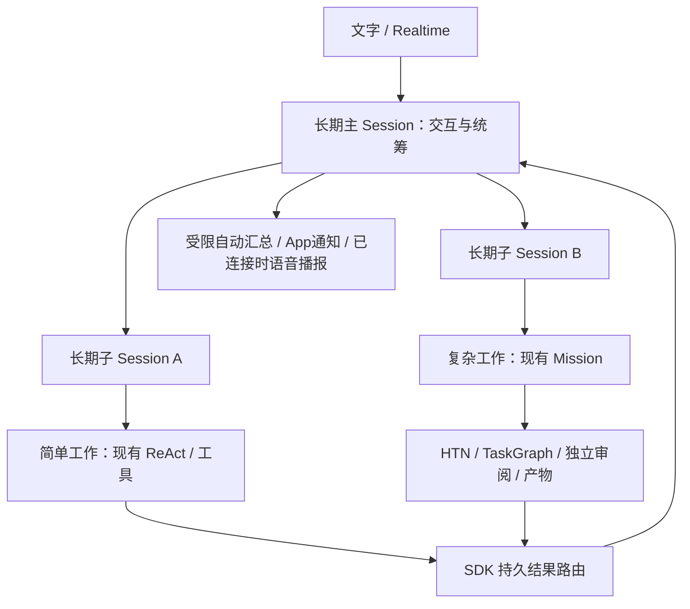

# SDK 统一交接：长期主 Session、多子 Session 与 opt.222 阻断

日期：2026-10-30。用途：可直接交给 SDK 团队评估、实现和发版；AIPhone 等正式制品后接入。
本轮只调研和写文档，没有改业务代码、手机配置、SDK 轮子或既有验收账本。

## 1. 用户目标与已确认的决定

用户希望保留手机 Linux 本地执行：长期存在的主 Session 负责交互、理解目标、决定是否委派并统筹
多个子 Session；主 Session 自己不使用 HTN/TaskGraph，复杂子工作充分复用 SDK 的 Mission、
HTN/TaskGraph、独立审阅、预算、授权、产物与恢复能力。Session、父子关系和调度都进入 SDK，
其他应用也能复用；AIPhone 只负责界面、输入输出、手机工具和平台通知适配。

用户在本轮明确选择：

1. 子 Session 要能持续追问、追加问题和修改要求，不能一次任务完成就销毁。
2. 子工作完成后，主 Session 自动汇总并通知；额外模型调用必须受预算和合并频率限制。

建议首版采用一层主子关系，可有多个兄弟子 Session；子 Session 内复杂工作的分层依赖交给现有
HTN/TaskGraph，不先扩展任意递归会话树。具体并发值和合并窗口由 SDK 提供配置、在手机实测后定。
上述两项产品取舍已经确认；本轮不再让用户决定线程数、SQLite 布局或接口拼写等实现细节。

## 2. 核实基线与证据口径

- 正式 SDK：`0.13.0.dev20260925+opt.222`，wheel SHA256：
  `dfb1a11ce373587b29b6ca86bdb4847794b8fc4d1df5355d0f9dfb215c93fa0a`。
- Service SDK：0.3.20。SDK 远端 main 核实为 `47fd34f0da65667817d30f1994e73523b5aaf8ba`。
- 阅读正式 wheel 与该提交的源码，12 个关键文件逐字节相同；未使用带 WIP 的源码工作树运行。
- 主要依据：[接入文档 §2d/2e][S0]、公开导出和实际实现；测试只读用于核对设计意图，
  本轮没有运行新能力测试或真实模型，不能宣称新增多子会话已经可用。
- 原 opt.222 手机测试属于已发生的独立证据，下文单列；旧冻结结果不覆盖、不重新计数。

### 已有能力与差距

| 能力 | 当前实际情况 | 本次处理要求 |
|---|---|---|
| 一个 Host、多独立 Session | 已有 `host.open_session(id)`；同号并发初始化一次，重开恢复，各会话隔离 [S1] | 保留并复用，不为每个子会话另起 Host/数据根 |
| 主会话决定委派 | 已有 SDK 内建 `delegate_task/task_status/task_cancel`；普通聊天不走 HTN [S2] | 继续由模型决定、SDK 准入，App 不解析模型文字来建任务 |
| Session→Mission | 已有持久意图、恢复、取消收敛与 opt.222 稳定槽位 [S3] | 保留原语，复杂子工作继续使用现有编排 |
| 同时多个 Mission | 每个 Session 的一个在途限制在实现中固定，`SessionPolicy` 没有相应配置 [S3][S4] | 首版多个子 Session 各自一个在途 Mission 即可；无需先放开一个 Session 多 Mission |
| 父子 Session | 当前只有平级独立 Session，没有持久 parent/root 关系和子会话公开控制合同 [S1][S4] | SDK 增加关系、可信归属、创建/消息幂等和恢复 |
| 结果与审批 | 已有本 Session 所属 Mission 的 inbox、ack、人工请求版本校验 [S5][S4] | 补子 Session→主 Session 结果与人工卡片路由；不能让主模型冒充人批准 |
| 自动主会话汇总 | 文字结果在下一次 `send` 时带入；不会自动启动父会话总结 [S4][S5] | 新增受预算、去重、限频和生命周期约束的自动协调回合 |
| 长历史 | 原生 Agent 有结构折叠与 Journal 回读；公开 `Session.history` 最多50条；执行者换代补入该历史 [S6][S7] | 复用已有上下文机制，补长期业务状态与跨执行者可定位的历史引用 |
| 统一限流 | 每个 Session 独立组装聊天 runtime，准入门按 runtime/wire 创建 [S8] | Host 统一预算/并发与前台优先；不能把每池上限当作全机上限 |
| 会话族预算 | 当前 `Session.budget()` 是账本引用及全局预算，没有主子归属与分配 [S4] | 加根预算约束与派生视图，费用仍由原账本唯一结算 |
| 底层 Agent | `BaseAgent/AgentRuntime/build_agent_runtime` 已从公开根模块导出；底层 delegate 是单层子 AgentTurn [S9][S10] | SDK 内部复用；底层 Agent 不能直接替代含身份、任务、审批与收件箱的产品 Session |
| Realtime | 有 Session voice 绑定与工具桥；现有链路尚有实机失败 [S11] | 只绑定主 Session，语音和文字共用统筹权威；子会话默认不各开麦克风/语音连接 |

文档差异也要修：当前 §2d 仍描述“会话+回合+目标哈希”的委派键；opt.222 实际已改为稳定
turn+slot，且 `receipt.delegations` 为事实、恢复后的 `tool_calls` 可为空。请与轮子同步更新。

## 3. 主要矛盾与建议结构

主要矛盾不是增加几个模型实例，而是：**长期会话需要稳定身份、跨执行者保留工作归属和结果；
现有 SDK 的产品层只保证独立 Session 与各自 Mission，且停止回合会污染执行者可用性。**

必须区分三种寿命：

- Session：长期用户/主题身份，历史、授权关系和收件箱可恢复。
- 一次工作：某次用户请求、委派及其结果版本；完成后可追加新的工作。
- 执行 Agent/模型连接：可以取消、达到寿命、失败或换代；不能带走 Session 身份和未完成任务。

一个子 Session 完成 Mission 后变为空闲、可继续追问；不能把 Mission COMPLETED 当作子会话关闭。
追加要求产生新的输入/工作及必要的新 Mission，旧任务事实不倒改。修改进行中工作时，SDK要明确
何时调用现有版本化要求修改入口，何时需取消旧工作后另建；普通追问不能误创建任务，opt.222的
spec_drift重放报告也不能冒充修改成功。停止主会话回答不取消子工作；
关闭 App 不取消后台工作；明确取消某项才影响对应目标。

强依赖的复杂工作优先放在一个 Mission：例如“调研再写报告”让现有 TaskGraph 处理依赖与验收。
多个子 Session 用于持续主题或独立工作，不把每个 HTN 叶子步骤重新包装成一个 Session。
首版不另造跨 Session 的通用 DAG；主会话需要协作时引用指定子结果的版本发起后续工作。

## 4. SDK 应补齐的公开合同

以下名称只是语义示例，不是当前已有接口，也不要求机械新增所有同名方法。优先深化现有 Session。

| 合同 | 必须保证的行为 |
|---|---|
| 主子关系与发现，如 `spawn_child/children/child` | SDK 注入 root/parent/principal/tenant；持久且无环；同意图重试一个子会话；模型只提出目标、资料与简短原因，不能自定可信归属 |
| 子会话继续输入与控制，如 `send_to_child/interrupt_child/archive_child` | 区分用户补充、主会话委派、子结果资料；追加输入有稳定幂等键、工作关联和版本；停止回答、取消 Mission、归档会话分别定义 |
| 统筹视图，如 `snapshot/requests/results` | 主会话可见授权子会话的真实工作、Mission、产物和待人工事项；分页读取。UI 不扫私有库或自己拼事实 |
| 持久事件与投递 | 事件含来源 session、turn、delegation/mission、结果版本、因果关联；补读游标明确；至少一次投递、幂等应用，不承诺网络/模型天然恰好一次 |
| 自动协调回合 | 子结果到达时由 SDK 持久排队，在主会话安全回合边界执行；结果作为资料，不能伪装新用户发言；总结有专属幂等身份、预算、合并窗口和失败出口 |
| 权限、预算、统一准入 | 子能力只缩不放；按原用量事实归属根/子，原账本唯一结算；同 Host 全局限流与前台优先，不按 Session 个数放大上限 |
| 长期恢复与上下文 | root 已知即可发现并恢复子关系、未决消息、结果和审批；执行者安全换代不换逻辑 Session；工作摘要有来源版本，原历史可分页回读 |
| 能力及健康状态 | 公开报告可用功能、待恢复/未知费用/预算耗尽/中继错误及可重试性；文字读接口在模型不可用时仍可用；提供消费者可用的诊断关联 |

可以复用公开 BaseAgent 的幂等输入、journal、取消与恢复，及 Mission 的规划/审阅/产物；
不能要求 AIPhone 接私有 Agent 模块、读写 SDK ledger、维护第二套父子/预算/恢复状态机。
SDK 模型目录要内建相应控制命令；创建或取消子工作不能伪装为应用只读 DomainTool。

### 自动汇总的具体语义

1. 用户已批准自动汇总。以子会话、工作来源 turn/delegation/mission、结果版本构成稳定投递事实；
   不能仅按 child_session_id 去重一次，否则持续追问后的第二个结果会被吞掉。
2. 同时完成的多个结果可在可配置窗口合并，一批事实只有一个已提交总结；主会话正在回答时排队，
   不抢同一逻辑写入者，不持主回合锁等待长任务。
3. 结果通知、模型已应用、用户已查看、语音实际已播放分别记录；发了通知不等于人已确认收到。
4. 默认自动回合只汇总原结果，不自行新建或取消工作。若后续支持自动推进，必须关联原有用户授权
   与剩余预算，不能把结果正文中的“继续执行”当成新授权。
5. 根已归档、预算不足、模型不可用时仍保存结构化状态与产物，并给应用通知事实；不能循环唤醒模型。
6. 未知计费的汇总请求不自动重放；新执行者可处理新意图，原未知账保留，不能永久拖死主会话。

语音已有可复用部分：`VoiceBinding._schedule` 已将本Session的 result_ready/needs_response 排队播报
（realtime_bridge.py:771起），不用另造播报循环。但 `attach_voice` 持有主Session发送锁直到解绑，
不能简单在通话中调用普通 `Session.send` 做自动总结，否则会一直等待。SDK应按当前通道所有者
路由同一份结果：文字模式使用串行协调回合，原生语音模式使用现有播报/上下文接缝并正确提交来源；
不同时运行两套业务决策模型。用户正在说话时等待安全边界，不能用重绑或伪造用户发言强行插入。

### 手机资源与长期运行

- 会话存在不等于全部执行池常驻；SDK 支持空闲子会话释放资源、之后按ID恢复。
- 统一限制打开的执行者、文本模型请求、工具并发、任务并发和本机音频资源；分别公开实际范围。
  `max_active_children` 与“真正同时调用模型几路”要分开。
- 手机先测 Host 总文本并发上限1时绝不超发，再测允许2时的前台响应和后台吞吐；默认值据实测选定。
  不能为了前台抢占而取消已交给 provider 的后台调用、制造未知费用。
- Realtime 连接是独立资源，不应在整个通话期间占住文本请求唯一许可；实体麦克风/扬声器只归主语音。
- 已见同步 Session pump/snapshot 的性能线索；多会话前先测事件循环延迟、音频队列和闲置CPU。
  不以无限增大队列掩盖延迟。UI 按游标增量读，不每次从0回放所有长期历史。
- 长期目标、用户决定、当前子工作与产物引用属于可追溯状态摘要；模型摘要不能改写权威任务状态。
  现有结构折叠继续复用，SDK 要明确换代后如何回读50条之外的历史。

## 5. 与本轮一起修的已有阻断

### F1 / P1：停止回答后原 Session 无法继续（根因已确认）

正式 opt.222 手机原 main Session：App 在请求已交给 provider 时点击停止，回执
failed/agent_turn_cancelled、usage.unknown=true；随后新 key 的委派在467ms内失败，
error=react_cost_exceeded、model_calls=0。服务重启后，新 key 发 hello 仍是同样失败。

原执行者仍 lifecycle=open；该 provider 调用 state=unknown、
error=provider_cancelled_after_handoff、budget.amount_micros=null。正式源码的 `_given_up`
只识别已关闭或仍有 open turn 的 provider blocker，漏掉这种“回合已取消、执行者仍open”的情况；
termination 对 has_unknown_charge 无条件拒绝。独立只读评审已确认。增加额度不解决。

SDK 必须提供安全执行者换代/权威对账，保留原逻辑 Session、历史、委派及未知费用；不把未知改零，
不重放已交给 provider 的旧请求，不让用户换新会话才能聊天。这个修复是长期主 Session 的前置条件。

### F2：语音中继协议终止（来源明确，具体触发原因待联合定位）

Service0.3.20+opt.222 原 main Session，在已确认工具目录后，修复音频版本的有界录音复测：
41次音频发送、单次最长约3.8ms；中继返回 SessionFailed，字段为
`tokenseller.error / protocol_error / upstream_protocol_error / fatal=true / retryable=false`，
failure.stage=control.terminal。第一轮尚未完成；最终音频资源释放。

这证明终止控制事件由中继发来，不能据此断言上游模型本身有缺陷。SDK/Service/中继需提供同一
correlation、binding generation、response/item/call 的诊断关联，定位协议转换/上游拒绝的触发。

### F3：上下文来源混淆

原 main Session 注入的“任务结果资料（不是用户指令）”曾被记成语音用户输入，并产生回答。
请核验 context_ack_id、ASR item来源、trigger_response=false 与响应来源映射；加入确定性反例。
这与未来子结果自动回流直接相关：不能靠文本前缀或关键字过滤来保证授权，需可信来源类型和因果关联。

### 已修或已通过的内容，不重复列为待修

- opt.222 同键重复委派 P1：真实“delegation已写/外层receipt未写”窗口 SIGKILL，服务恢复后在途重放，
  任务 COMPLETED 后 App 再重试，始终1个mission、1个delegation、1份mission配额；
  tool_calls=[]时仍从delegations取原任务。文件、ack和后续结果应用已通过。
- 手机 GI MapInfo 采集故障：AIPhone 已改用 GStreamer extract_dup；精确候选8轮各100帧采集正常并释放。
  App修复后也采集289帧、无本地音频错误，仍遇F2；不能把本地故障与中继故障混为一项。
- 整机恢复、文件回读、独立任务入口取消、真实安装回退再恢复已通过，不代替新增主子统筹验收。

原始实机详情见 AIPhone 的 opt.222 阻断交接；私有备份6900237字节、SHA256
`9be126df306e54c86e7292ac2b5086c9ccc98777db00ae5ff645a304c97c04ad`。
不公开上传原始库、对话、设备信息、凭据或音频；需要证据时经现有私有交接渠道提供。
直接出处：[手机阻断报告](../2026-10-30-opt222-integration/SDK-BLOCKER-HANDOFF-opt222-2026-10-30.md)、
[完整验收与封存记录](../2026-10-30-opt222-integration/journal.md)。转交本文件时可附这两份文字报告，
不必附原始数据库；本文件已保留关键复现和错误字段。

## 6. 验收标准：SDK 先过，手机再验

下表为待实现的验收要求，不是本轮通过报告。SDK侧用正式轮子在仓库外消费者验证，
再由 AIPhone 在 Linux aarch64/Python3.13 真机从 App 入口复验；mock不能替代手机和真实线路。

| 编号 | 场景与独立预期 |
|---|---|
| A01 | 同一 root 下至少2个持续子会话，各执行不同工作。主会话仍能普通聊天，不被强制进入HTN |
| A02 | 子会话复杂工作生成真实Mission，HTN/TaskGraph执行并独立验收产物；受理不显示为完成 |
| A03 | 子工作完成后自动回主会话、汇总通知；第二次追问仍复用原子Session，产生新工作与新版本结果 |
| A04 | 重复投递、服务重启、同key恢复和执行者换代各窗口：同意图不重复创建子Session/Mission，不重复结算；新key新工作正常 |
| A05 | provider接纳前后、文本流中、工具前后停止：原Session新key的普通聊天和委派都继续；未知费用保留可追溯，不重放旧收费请求 |
| A06 | 停主回答、停指定子回答、取消指定Mission、归档子会话、关闭App逐项测试；兄弟任务不被误取消，完成/取消竞态如实呈现 |
| A07 | 两个子结果同时到、主回合正忙、汇总中崩溃：合并有界，提交总结去重；无预算或根归档时保留结果且不自激调用 |
| A08 | 从root恢复整个关系和待办，包含创建中、等审批、运行中、未汇总、未读结果；整机重启不丢归属、无孤儿工作 |
| A09 | 另一无关Session不能读取/控制子工作；伪造parent、来源、审批或结果被拒；用户真实审批按child/request/version正确路由 |
| A10 | Host总模型上限1时，多Session+Mission同时发请求，观测最大在途确为1；上限2时测前台优先和后台公平，不能按Session数量翻倍 |
| A11 | 根/子/chat/mission/voice计量引用可对账，一次费用只结算一次；预算不足仍能无模型读状态、文件与取消 |
| A12 | 历史超过50条并达到多个上下文窗口后，换代仍能恢复早期明确约束、子工作/产物引用，并可回读原文；不只验证ID还在 |
| A13 | 子结果和外部产物含“批准/删除/再建任务”等指令：只作为资料；自动汇总不获得新用户授权；权限只缩不放 |
| A14 | 原主Session文字/语音切换、三轮对话、真人打断、断线重连、同号重绑；保持attach且不detach，在提供方正常、用户未讲话且无当前播报的安全窗口内，后台子结果在配置的最大等待时间内汇总/播报；忙时可见排队、不丢结果。不并启另一文字业务模型、不永久等待send锁；后台工作继续，子结果不变成ASR输入，未播完不记已听到 |
| A15 | 多个活跃子会话+长历史下测闲置CPU、事件循环阻塞、前台/音频延迟和资源释放；SDK实现前先据可复现基线冻结阈值，再做复验，不能实现后任意设阈值或只给readiness |
| A16 | 同时两份仓库外应用只用公开接口能复现同一能力；安装/回退/恢复不打开不兼容旧库，无AIPhone私有调度、私有ledger依赖 |

测试应分成三个可独立报告的闭环：F1停止恢复、多子会话统筹、Realtime。F2中继阻断不能掩盖文字
未完成项，也不能拿文字通过宣布语音通过。真人语音听感仍待线路修好后进行；用户已表示可以配合。

## 7. 分阶段交付与兼容要求

1. 先用小修复版本解决F1，保留opt.222已通过的幂等恢复；F1需先红后绿回归。
   F2/F3可联合Service/中继并行定位，不让语音外部阻断拖住可独立交付的文字修复。
2. 交付一层多持续子Session、Host统一准入、结果自动回流和长期恢复；复用现有Agent/Mission。
3. 独立审阅累计修改，完成仓库外正式wheel与已知线路验证，最后交AIPhone按A01～A16复验。

统一交接不要求所有内容挤在一次发版：紧急恢复修复、持续子会话能力、语音修复分别给版本和验收结果。

交付物必须包含：wheel+SHA256SUMS、源码/制品身份、公开导出/错误码/事件与配置文档、
可运行最短消费者（文字及可选语音）、复现测试与验收结果、已知限制和未通过项。
Service SDK是否升级由实际改动决定，不能只换编排SDK版本号就宣布协议问题解决。

新能力显式启用，旧独立Session与旧delegate_task默认语义保留；工具/提示词/策略冻结与新池身份由
SDK处理，不能要求宿主修改旧池身份。本轮开发期可声明一次新根起步，不要求迁移opt.221；
长期能力发布后必须给出schema/策略版本的兼容范围与升级/备份恢复路径，不能默认为每次升级丢根重来。

AIPhone接入差距：当前只打开固定main，IPC没有子会话目标，UI只读该Session任务，事件从0补读。
SDK发版后再改为调用公开统筹视图/增量事件，补子会话导航、人工卡片和通知；保留手机工具与
AudioIO适配。**本轮不先在AIPhone写这些机制，也没有向SDK/中继团队发送消息或发布制品。**

充分复用还包括现有资料版本、方法库、上下文档位、人工提问/规划授权/要求确认/外部操作审批与
接管裁决等接口；统筹视图应路由这些已有能力，不能只露“创建任务”一个按钮。缺少业务工具仍是
独立接入差距：当前AIPhone注册的手机工具是host_ping/device_get_status/app_list；本轮未核实
额外Web/GitHub检索工具可用，不能仅凭升级编排便承诺“GitHub调研”已有真实数据来源。

## 8. 来源索引

以下链接固定到已核实提交；轮子对应源码逐字节核验见本轮私有 source-identity.json。
详细只读能力评估另见同目录 capability-assessment.md，包含底层实现和官方测试的证明范围。

[S0]: https://github.com/DennyWanye/simple_harness/blob/47fd34f0da65667817d30f1994e73523b5aaf8ba/sdk/simple-harness-sdk/docs/orchestration-host.md
[S1]: https://github.com/DennyWanye/simple_harness/blob/47fd34f0da65667817d30f1994e73523b5aaf8ba/sdk/simple-harness-sdk/src/agent_orchestrator/host/sessions.py#L15-L54
[S2]: https://github.com/DennyWanye/simple_harness/blob/47fd34f0da65667817d30f1994e73523b5aaf8ba/sdk/simple-harness-sdk/src/agent_orchestrator/host/session_chat.py#L20-L99
[S3]: https://github.com/DennyWanye/simple_harness/blob/47fd34f0da65667817d30f1994e73523b5aaf8ba/sdk/simple-harness-sdk/src/agent_orchestrator/host/delegation.py#L81-L173
[S4]: https://github.com/DennyWanye/simple_harness/blob/47fd34f0da65667817d30f1994e73523b5aaf8ba/sdk/simple-harness-sdk/src/agent_orchestrator/host/session.py
[S5]: https://github.com/DennyWanye/simple_harness/blob/47fd34f0da65667817d30f1994e73523b5aaf8ba/sdk/simple-harness-sdk/src/agent_orchestrator/host/inbox.py#L27-L104
[S6]: https://github.com/DennyWanye/simple_harness/blob/47fd34f0da65667817d30f1994e73523b5aaf8ba/sdk/simple-harness-sdk/src/simple_harness/agents/context/composer.py#L54-L91
[S7]: https://github.com/DennyWanye/simple_harness/blob/47fd34f0da65667817d30f1994e73523b5aaf8ba/sdk/simple-harness-sdk/src/agent_orchestrator/host/session_chat.py#L244-L296
[S8]: https://github.com/DennyWanye/simple_harness/blob/47fd34f0da65667817d30f1994e73523b5aaf8ba/sdk/simple-harness-sdk/src/agent_orchestrator/host/chat.py#L116-L156
[S9]: https://github.com/DennyWanye/simple_harness/blob/47fd34f0da65667817d30f1994e73523b5aaf8ba/sdk/simple-harness-sdk/src/simple_harness/__init__.py#L362-L375
[S10]: https://github.com/DennyWanye/simple_harness/blob/47fd34f0da65667817d30f1994e73523b5aaf8ba/sdk/simple-harness-sdk/src/simple_harness/agents/tools/delegate.py
[S11]: https://github.com/DennyWanye/simple_harness/blob/47fd34f0da65667817d30f1994e73523b5aaf8ba/sdk/simple-harness-sdk/src/agent_orchestrator/host/realtime_bridge.py
